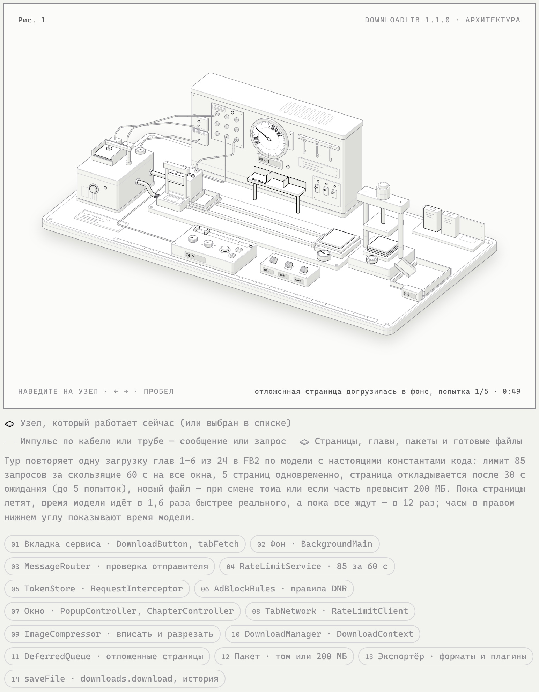

# Архитектура DownloadLib

Документ описывает устройство расширения версии 1.1.0: из каких частей оно состоит, как части общаются между собой и как проходит загрузка тайтла. Он пригодится, если вы правите код расширения, пишете плагин или разбираетесь в ошибке.

**Содержание**

1. [Схема](#схема)
2. [Коротко об устройстве](#коротко-об-устройстве)
3. [Структура репозитория](#структура-репозитория)
4. [Контексты исполнения](#контексты-исполнения)
5. [Владельцы общих задач](#владельцы-общих-задач)
6. [Сообщения между контекстами](#сообщения-между-контекстами)
7. [Модули и точки входа](#модули-и-точки-входа)
8. [Как проходит загрузка](#как-проходит-загрузка)
9. [Контракт плагинов](#контракт-плагинов)
10. [Справочник модулей](#справочник-модулей)
11. [Как добавить экспортёр](#как-добавить-экспортёр)
12. [Как добавить сервис](#как-добавить-сервис)

---

## Схема

<p align="center">
  <a href="https://raw.githack.com/ivanvit100/DownloadLib/master/screenshots/architecture.html">
    
  </a>
</p>

<p align="center">
  <b><a href="https://raw.githack.com/ivanvit100/DownloadLib/master/screenshots/architecture.html">▶ Открыть интерактивную схему</a></b>
  · <a href="https://raw.githack.com/ivanvit100/DownloadLib/master/screenshots/architecture-dark.html">тёмная тема</a>
</p>


**Узлы схемы**

| № | Узел | Где в коде |
|---|---|---|
| 01 | Вкладка сервиса | [`content/DownloadButton.js`](#contentdownloadbuttonjs), `tabFetch` из [`core/TabNetwork.js`](#coretabnetworkjs) |
| 02 | Фон | [`background/BackgroundMain.js`](#backgroundbackgroundmainjs) |
| 03 | Маршрутизатор сообщений, проверка отправителя | [`background/MessageRouter.js`](#backgroundmessagerouterjs) |
| 04 | Общий ограничитель: 85 запросов за 60 с | [`background/RateLimitService.js`](#backgroundratelimitservicejs), [`core/RateLimiter.js`](#coreratelimiterjs) |
| 05 | Токены авторизации | [`background/TokenStore.js`](#backgroundtokenstorejs), [`background/RequestInterceptor.js`](#backgroundrequestinterceptorjs) |
| 06 | Блокировка рекламы (правила DNR) | [`background/AdBlockRules.js`](#backgroundadblockrulesjs) |
| 07 | Окно расширения | [`ui/PopupController.js`](#uipopupcontrollerjs), [`ui/ChapterController.js`](#uichaptercontrollerjs) |
| 08 | Сетевой слой и клиент ограничителя | [`core/TabNetwork.js`](#coretabnetworkjs), [`core/RateLimitClient.js`](#coreratelimitclientjs) |
| 09 | Вписывание и нарезка страниц | [`core/ImageCompressor.js`](#coreimagecompressorjs) |
| 10 | Движок загрузки | [`core/DownloadManager.js`](#coredownloadmanagerjs), [`core/DownloadContext.js`](#coredownloadcontextjs) |
| 11 | Отложенные страницы и главы | [`core/DeferredQueue.js`](#coredeferredqueuejs) |
| 12 | Пакет: том или 200 МБ | `DownloadManager.downloadWithSizeLimit` |
| 13 | Экспортёр: встроенные форматы и плагины | [`exporters/`](#экспортёры-exporters), [`core/PluginManager.js`](#corepluginmanagerjs) |
| 14 | Сохранение файла и история | `DownloadManager.saveFile`, [`core/DownloadHistory.js`](#coredownloadhistoryjs) |

---

## Коротко об устройстве

1. **Три изолированных контекста.** Страницы расширения (попап, окно загрузки, окно настроек), фон и content scripts на сайтах сервисов. Друг с другом они общаются только сообщениями.
2. **Запросы к сервису идут из его вкладки.** Расширение не подделывает заголовки: каждый запрос к API и каждая картинка загружаются кодом, внедрённым в открытую вкладку сервиса, поэтому браузер сам подставляет cookies, Referer и Origin сайта.
3. **Один лимит на всё расширение.** Ограничитель частоты живёт в фоне, и любое окно перед запросом получает у него разрешение. Ответ 429 притормаживает все окна сразу.
4. **Загрузка живёт в окне загрузки.** Движок, экспорт и сохранение файла работают в отдельном окне расширения. Фон тонкий: лимит, токены, реклама и маршрутизация сообщений.
5. **Сервисы и форматы — реестры.** Встроенные регистрируются модулями `BuiltinServices.js` и `BuiltinExporters.js`, пользовательские — плагинами.
6. **Плагинам гарантирован стабильный контракт.** Всё, на что опираются плагины, не меняется во всех версиях 1.x (см. [«Контракт плагинов»](#контракт-плагинов)).

---

## Структура репозитория

```
app.js                    точка входа страниц расширения (composition root)
popup.html                попап; тот же файл открывается окном загрузки и окном настроек
background/               фон: точка входа, маршрутизация сообщений, лимит, токены, реклама
content/                  content scripts на сайтах сервисов: кнопка «Скачать», чистка рекламы
core/                     ядро: сеть, лимиты, авторизация, движок загрузки, плагины, утилиты
services/                 сервисы-источники: реестр, базовые классы, mangalib/, ranobelib/
exporters/                форматы: реестр, BaseExporter, FB2, EPUB, MOBI, PDF, Simple
ui/                       контроллеры экранов попапа
templates/                HTML-шаблоны экранов
css/ui.css                все презентационные стили
lib/                      сторонние JSZip и html2pdf (классические скрипты)
plugins/                  эталонные плагины, на которых проверяется контракт
sandbox.html, sandbox.js  песочница для плагинов формата
sw.js                     service worker виртуального пути /plugin-runtime/
manifest.chrome.json      манифест MV3 для Chrome
manifest.firefox.json     манифест MV3 для Firefox (правится параллельно с Chrome)
tests/                    тесты Vitest, повторяют структуру каталогов
```

---

## Контексты исполнения

| Контекст | Файлы | Что делает |
|---|---|---|
| **Страницы расширения** | `popup.html` → `app.js` | Попап открывается по клику на иконку расширения. Тот же `popup.html` открывается отдельным окном для загрузки (`?download=true&…`) и для настроек (`?settings=true`). Есть доступ к DOM и `fetch`, но перехватывать сетевые запросы страница не может. |
| **Фон** | Firefox: `background/background.html`; Chrome: модульный service worker `background/service-worker.js`. Оба загружают `background/BackgroundMain.js` | Общий ограничитель частоты, хранилище токенов, захват токенов из запросов страниц сервиса, правила блокировки рекламы, маршрутизация сообщений, регистрация content scripts. |
| **Content scripts** | `content/AdCleaner.js`, `content/DownloadButton.js` | Работают на страницах сайтов: убирают рекламу и добавляют кнопку «Скачать». В логике загрузки не участвуют. |

- Общение между контекстами — только через `runtime.sendMessage` / `runtime.onMessage`. Напрямую вызывать функции другого контекста нельзя.
- Фон не загружает экспортёры, JSZip, MangaPatcher и классы сервисов. Это проверяет `tests/ModuleGraph.test.js`.

---

## Владельцы общих задач

У каждой общей задачи один владелец, остальные обращаются к нему:

| Задача | Владелец |
|---|---|
| Ограничение частоты запросов к сервису для всех окон | фон, `background/RateLimitService.js`; окна обращаются через `core/RateLimitClient.js` |
| Токены авторизации | фон, `background/TokenStore.js` (`storage.session`) |
| Сетевой запрос в контексте вкладки сервиса | `core/TabNetwork.js` (`fetchViaTab`, `requestViaTab`); перед каждым запросом — `RateLimitClient.acquire` |
| Движок загрузки, экспорт, сохранение | окно загрузки (`DownloadManager`) |
| Пауза, остановка, отложенные загрузки и колбэки одной загрузки | `core/DownloadContext.js`: свой контекст у каждой загрузки, сервис получает его через `service.attach(ctx)` |
| Экземпляр сервиса загрузки (заголовки, токен) | `serviceRegistry.createService(key)`: свой экземпляр у каждой загрузки и у окна, конфиг копируется |

---

## Сообщения между контекстами

Имена действий — константы `MSG` из `core/MessageTypes.js`, имя порта keep-alive — `PORT_KEEP_ALIVE`. Content scripts не импортируют модули, поэтому `DownloadButton.js` пишет строку `'openDownloadWindow'`. Её совпадение с `MSG.OPEN_DOWNLOAD_WINDOW` проверяет тест.

| Действие | Отправитель | Что делает фон |
|---|---|---|
| `getAuthToken`, `cacheAuthToken`, `authInvalidate` | страницы расширения (`AuthManager`) | читает, сохраняет, удаляет токен сервиса в `TokenStore` |
| `rateAcquire` `{serviceKey}` | страницы расширения (`RateLimitClient`) | отвечает `{ok: true}`, когда общий ограничитель разрешит запрос |
| `rateThrottle` `{ms}` | страницы расширения (`RateLimitClient`) | блокирует запросы всех окон, отвечает `{ok: true, blockedUntil}` |
| `openWindowWithUrl` `{url}` | страницы расширения | открывает окно расширения |
| `plugin:cache`, `plugin:exec` | страницы расширения (`PluginManager`) | кэширует код плагина, выполняет его во вкладке |
| `openDownloadWindow` `{format}` | `DownloadButton.js` на сайте сервиса или сервисного плагина | открывает окно загрузки тайтла этой вкладки |

Кроме сообщений, окно загрузки держит открытым порт `downloadKeepAlive`, чтобы фон Chrome не выгружался посреди загрузки.

**Проверка отправителя.** У каждого обработчика задано, кто может его вызвать. Сообщение принимается, только если `sender.id` совпадает с id расширения и:
- для страниц расширения — `sender.url` находится в origin расширения;
- для вкладок сервиса — `sender.tab.url` на сайте встроенного сервиса или включённого сервисного плагина.

Иначе фон отвечает `{ok: false, error: 'forbidden'}`. Ошибка обработчика превращается в ответ `{ok: false, error}`.

---

## Модули и точки входа

### ES-модули

Код в `core/`, `services/`, `exporters/`, `ui/`, `background/` и `app.js` написан как нативные ES-модули без сборки: зависимости подключаются через `import`, публичный API — через `export`. Глобальные переменные модули не создают; единственное намеренное исключение — `core/PluginApi.js` (см. [«Как плагины получают API»](#как-плагины-получают-api)).

Классическими скриптами остаются:
- `content/*.js` — MV3 не загружает content scripts как модули. API расширения они получают выражением `globalThis.browser ?? globalThis.chrome`.
- `sandbox.js` и `sw.js`.
- Сторонние `lib/jszip.min.js` и `lib/html2pdf.min.js`. Они подключаются в `popup.html` обычными `<script>`, модули обращаются к ним через `globalThis.JSZip` и `globalThis.html2pdf`.

### Точки входа

- `popup.html` → `app.js`. Это composition root страниц расширения: импортирует `core/PluginApi.js`, `services/BuiltinServices.js`, `exporters/BuiltinExporters.js`, затем вызывает `PluginManager.loadAll()` и создаёт `PopupController`.
- `background/background.html` и `background/service-worker.js` → `background/BackgroundMain.js`.

### Регистрация встроенных сервисов и экспортёров

Классы сервисов и экспортёров сами себя не регистрируют. Это делают два модуля регистрации встроенных классов:

```js
// services/BuiltinServices.js
serviceRegistry.register(MangaLibService);
serviceRegistry.register(RanobeLibService);

// exporters/BuiltinExporters.js
ExporterRegistry.register('fb2', FB2Exporter, { label: 'FB2' });
// … epub, mobi, pdf, simple
```

Порядок вызовов `ExporterRegistry.register` задаёт порядок форматов в селекторе.

---

## Как проходит загрузка

Вкратце:

1. **Попап на странице тайтла.** `PopupController` определяет сервис по адресу вкладки, создаёт свой экземпляр сервиса, подставляет токен, загружает метаданные и список глав.
2. **Окно загрузки.** Кнопка «Скачать» в попапе или на сайте открывает `popup.html?download=true&…` отдельным окном. Окно повторяет шаг 1 и запускает `DownloadManager`.
3. **Главы и страницы.** `DownloadManager` создаёт собственный экземпляр сервиса и `DownloadContext`, выбирает главы диапазона и загружает их по одной. Страницы главы загружаются по 5 одновременно, каждая — через общий ограничитель и вкладку сервиса. Всё, что ждёт дольше 30 с, догружается в фоне, не задерживая остальные главы тома; следующий том начинается, когда фоновые загрузки предыдущего завершились.
4. **Файлы.** Главы собираются в пакет до смены тома или до превышения «Макс. размера части». Пакет экспортируется в выбранный формат и сохраняется через `downloads.download`, после чего его память освобождается. Успешная загрузка попадает в историю.

Ошибки ответа сервиса обрабатываются в `BaseService._request`:

```
Ответ HTTP 429
    → RateLimitClient.throttle(ms)
        → runtime.sendMessage({ action: MSG.RATE_THROTTLE, ms })  [фон: блокировка для всех окон]
Ответ HTTP 401
    → AuthManager.invalidate(serviceKey)
        → runtime.sendMessage({ action: MSG.AUTH_INVALIDATE })    [фон: TokenStore]
```

---

## Контракт плагинов

Плагины пользователей должны работать без изменений во всех версиях 1.x. Ниже — всё, на что они могут опираться. Это **не меняется**: новое поведение добавляется новыми методами и полями рядом со старыми, старые имена остаются и делегируют к новым. Исправления ошибок допустимы, если не меняют сигнатуры и формы данных.

Контракт проверяют тесты `tests/plugins/` на настоящих файлах из `plugins/`: CBZ-экспортёр, HLib-сервис, снимок поверхности API, данные `export()`, песочница. Эти тесты не подгоняются под изменения внутри расширения: их изменение означает изменение контракта.

### Как плагины получают API

Плагины остаются классическими скриптами и не могут импортировать модули расширения. Поэтому `core/PluginApi.js` публикует их API в `globalThis`. Это единственное место в расширении с намеренными глобалами. `app.js` импортирует его до `PluginManager.loadAll()`.

- **Поддерживаемый API:** `BaseExporter`, `ExporterRegistry`, `BaseService`, `serviceRegistry`, а также `JSZip` и `html2pdf`. Последние два `popup.html` подключает обычными скриптами.
- **Устаревшие, но поддерживаемые глобалы** — то, что было доступно плагинам до версии 1.1. Они не удаляются (полный список — в пункте 6 ниже). Функции опубликованы обёртками: при изменениях внутри расширения правятся обёртки, а имена и формы результатов остаются прежними. Например:
  - `fetchViaTab` для плагинов по-прежнему возвращает `{ok, base64, contentType}` или `null`, хотя `TabNetwork.fetchViaTab` при неудаче возвращает `{ok: false, error}`;
  - `fetchPageImage(url, serviceKey)` загружает картинку через `TabNetwork` и возвращает `{ok, base64, contentType}` или `{ok: false, error}`, а без вкладки сервиса бросает `NoServiceTabError`;
  - `loadImageOrDefer(label, load)` откладывает картинку в текущей загрузке (`DownloadContext.current`), а вне загрузки просто выполняет `load()`;
  - `globalRateLimiter` — обёртка над `RateLimitClient`: `acquire`/`trackRequest` ждут разрешения общего ограничителя фона, `throttle` блокирует запросы всех окон, `setLimit` сохраняет лимит в настройки.

### Что гарантируется

**1. Метаданные и хранение**
- Теги в doc-комментарии плагина: `@dl-format`, `@dl-label` (плагин формата), `@dl-service`, `@dl-service-label`, `@dl-host` (плагин сервиса) и JSON-блок `@dl-service-config`.
- Записи `custom_plugins` в `storage.local`, кэши `__dl_plugin_formats__` и `__dl_plugin_services__` в `localStorage`.
- id content scripts плагинов `dl-plugin-<key>` и виртуальный путь кода `/plugin-runtime/<key>.js`.

**2. Поля `@dl-service-config`** и их смысл: `name`, `baseUrl`, `imagesDomain`, `imageServers` (`{domain, label, compress}`), `defaultImageServer`, `siteId`, `fields`, `headers`, `imageHeaders`, `splitLongImages`, `maxImageHeight`, `label`, `siteUrl`, `primaryColor`, `secondaryColor`, `logo`. Поля встроенных конфигов `hosts`, `imageHosts`, `titleUrl`, `adBlock` для плагинов необязательны: хосты плагина берутся из `@dl-host`.

**3. Загрузка кода плагина формата:** `plugin:exec` во вкладке расширения, `plugin:cache` + `/plugin-runtime/`, blob-модуль, в крайнем случае — песочница. Песочница (`sandbox.js`; в Firefox тот же текст встраивается в `srcdoc`) даёт заглушки `BaseService(config)`, `BaseExporter` с `escapeXml`/`escapeHtml`/`sanitizeText`/`stripHtml`/`extractText`, `ExporterRegistry.register` и протокол сообщений `sb-exec`/`sb-export`. Её API можно только расширять.

**4. Публичная поверхность классов** — имена, сигнатуры и формы результатов:
- `BaseExporter`: конструктор, `export`, `sanitizeText`, `escapeXml`, `escapeHtml`, `stripHtml`, `extractText`;
- `ExporterRegistry`: `register(format, Class, meta)`, `create`, `getSupportedFormats`, `getFormats`;
- `BaseService`:
  - поля `config`, `name`, `baseUrl` и геттер `extensionApi`;
  - запросы `fetchMangaMetadata(slug)`, `fetchChaptersList(slug)`, `fetchChapter(slug, number, volume, branchId, extraParams)` — возвращают разобранный JSON ответа (`{data: …}`). Расширение вызывает их через `getManga`/`getChapterList`/`getChapter`, поэтому переопределение в плагине учитывается;
  - `extractPages`, `checkpoint`, `interruptibleDelay`, `delay`, `fetchWithRetry`, `fetchWithRateLimitRetry`, `loadPageAsBase64`, `blobToBase64`, `static matches`;
- `ServiceRegistry` / `serviceRegistry`: `register`, `getServiceByUrl`, `getService`, `createService`, `getAllServices`;
- `ImageCompressor.compress(base64, contentType, options)` → `{base64, contentType}`, `MangaPatcher.patch(raw)`.

**5. Данные `export(manga, chapters, coverBase64)`**
- `manga` — объект `MangaPatcher.patch` с прежними полями (`name` дополнен номером тома и части);
- `chapters` — `[{title, content, volume, number}]`;
- блоки `content` — `{type: 'text', text}` и `{type: 'image', id, data: {base64, contentType}, originalIndex?}`;
- `coverBase64` — data-URL или `''`;
- результат — `{blob, filename, mimeType}`.

Новые поля только добавляются (так появились `key` у главы и `partIndex`/`totalParts` у частей разрезанной страницы), убирать и переименовывать нельзя. После того как промис `export()` разрешился и файл сохранён, расширение освобождает `content` глав пакета — экспортёр не должен рассчитывать на них после возврата.

**6. Глобалы** (публикует `core/PluginApi.js`)
- Поддерживаемый API: `BaseExporter`, `ExporterRegistry`, `BaseService`, `serviceRegistry`, а также `JSZip` и `html2pdf`.
- Устаревшие, но поддерживаемые — **не будут удалены**:
  - `ImageCompressor`, `MangaPatcher`, `EventBus`, `RateLimiter`, `globalRateLimiter`, `ServiceRegistry`;
  - `FB2Exporter`, `EPUBExporter`, `MOBIExporter`, `PDFExporter`, `SimpleExporter`, `MangaLibService`, `RanobeLibService`;
  - `mangalibConfig`, `ranolibConfig` (прежнее имя конфига RanobeLib);
  - `fetchPageImage`, `loadImageOrDefer`, `NoServiceTabError`;
  - `getExtensionApi`, `getBrowserEnv`, `extensionApi`, `browserEnv`;
  - `fetchViaTab`, `requestViaTab`, `hasServiceTab`, `setServiceTab`.
- В контракт **не входят**: внутреннее состояние приложения (UI-контроллеры, `DownloadManager`, `PluginManager`, `AuthManager`, `DownloadHistory`, `SafeStorage`, логгер) и runtime-сообщения фона, кроме `plugin:exec` и `plugin:cache`.

### Изменения поведения в 1.1, видимые плагинам

Это исправления без смены контракта:
- `stripHtml` раскодирует `&amp;` последним (`&amp;lt;` → текст «&lt;»);
- `BaseService.loadPageAsBase64` снова работает;
- сервисные плагины учитывают `splitLongImages`/`maxImageHeight` и галочку «Разделять страницы» — длинные страницы режутся так же, как в MangaLib;
- `EventBus.once` срабатывает ровно один раз, даже если колбэк бросил ошибку или повторно эмитит то же событие.

---

## Справочник модулей

Модули сгруппированы по слоям: фон, content scripts, ядро, сервисы, экспортёры, интерфейс.

### Фон (`background/`)

#### `background/BackgroundMain.js`

Точка входа фона. Подключает `RequestInterceptor` и `MessageRouter` (они устанавливают слушатели при импорте), включает отслеживание уровня логирования (`watchLogLevel`) и ставит правила блокировки рекламы (`installAdBlockRules`) — при загрузке фона и на `runtime.onStartup`.

#### `background/service-worker.js` и `background/background.html`

Оболочки фона для двух браузеров. `background.html` (Firefox) только подключает `BackgroundMain.js` как модуль. `service-worker.js` (Chrome) импортирует `BackgroundMain.js` и дополнительно обслуживает виртуальный путь `/plugin-runtime/`: по сообщению `CACHE_PLUGIN` кладёт код плагина в Cache Storage (`dl-plugins-v1`), а на `fetch` отдаёт его или заглушку 404.

#### `background/MessageRouter.js`

Маршрутизатор сообщений. Слушает `runtime.onMessage` и передаёт сообщение обработчику из таблицы `handlers` (действие → `{allow, handle}`), если отправителю он разрешён (см. [«Сообщения между контекстами»](#сообщения-между-контекстами)). Обработчики асинхронные. Единая обёртка отправляет их результат через `sendResponse`, а ошибку — как `{ok: false, error}`.

`openDownloadWindow` определяет slug и сервис по URL вкладки-отправителя. В URL окна загрузки передаются только `slug`, `service`, `format` и `tabId`. Остальные параметры загрузки, в том числе лимит запросов и лимит части файла (по размеру или по числу глав), окно берёт из настроек.

`plugin:cache` сохраняет код плагина: внутри service worker'а — в Cache Storage, в остальных случаях — в IndexedDB `dl-plugins`. `plugin:exec` выполняет код во вкладке через `scripting.executeScript`.

Принимает подключения порта `downloadKeepAlive`. Окно загрузки держит его открытым, чтобы фон Chrome не выгружался посреди загрузки.

Регистрирует content scripts (`scripting.registerContentScripts`): для встроенных сервисов — по `hosts` их конфигов, для включённых плагинов — по их хостам. Статических `content_scripts` в манифестах нет. При старте фона и при изменении списка плагинов регистрации сверяются с нужными: неизменённые не трогаются, устаревшие снимаются, новые добавляются по одной.

#### `background/RequestInterceptor.js`

Наблюдает за сетевыми запросами к сервисам. Сам запросы не делает и не считает: учёт частоты — только через `rateAcquire`. Ничего не экспортирует.

**Захват токенов (оба браузера).** Неблокирующий `webRequest.onBeforeSendHeaders`. Если страница сервиса обращается к API с заголовком `Authorization: Bearer …`, токен сохраняется в `TokenStore`. Сервис определяется:
1. по заголовку `Site-Id` встроенного сервиса;
2. иначе по хосту страницы, сделавшей запрос (`originUrl`/`initiator`), включая сайты сервисных плагинов.

Если сервис не определён, токен не сохраняется. Поэтому токен сайта плагина не затирает токен встроенного сервиса с тем же API.

**CORS изображений (только Firefox).** Блокирующий `onHeadersReceived` добавляет `Access-Control-Allow-Origin` к ответам на запросы изображений, у которых этого заголовка нет. Произвольный Origin никогда не отражается:
- Origin сайта встроенного сервиса — разрешается с `Access-Control-Allow-Credentials: true`;
- origin самого расширения — разрешается без credentials;
- любой другой Origin — заголовок не добавляется;
- запрос без Origin — origin расширения для запросов не из вкладки (`tabId -1`), иначе сайт сервиса, которому принадлежит CDN.

Origin запроса запоминается в `onBeforeSendHeaders` и забывается в `onHeadersReceived`, `onCompleted` или `onErrorOccurred`, так что карта не растёт.

Фильтр URL слушателей и распознавание сервиса берутся из `services/ServiceHosts.js`.

#### `background/TokenStore.js`

Единственное хранилище токенов авторизации. Токены лежат в `storage.session`: они переживают перезапуск service worker'а, но не закрытие браузера. Без `storage.session` токены хранятся только в памяти.

- `getToken(serviceKey)` — действующий токен сервиса; истёкший удаляется.
- `setToken(serviceKey, token)` — сохраняет токен; истёкший или пустой не сохраняет. Возвращает `true`, если значение изменилось.
- `invalidate(serviceKey)` — удаляет токен.
- `jwtExpiry(token)`, `isTokenUsable(token)` — проверка `exp` в JWT с запасом 30 с. Токен без `exp` считается действующим.

#### `background/RateLimitService.js`

Единственный экземпляр `RateLimiter` на всё расширение. Обслуживает сообщения `rateAcquire` и `rateThrottle` всех окон.
- Лимит читает из `storage.local['downloadlib_default_rate_limit']` до выдачи первого разрешения. Затем следит за этим ключом через `storage.onChanged`.
- Состояние (окно и блокировку) сохраняет в `storage.session` не чаще раза в секунду и восстанавливает после перезапуска service worker'а.

Экспортирует `acquire(serviceKey)`, `throttle(ms)` → `{blockedUntil}`, `getStats()`.

#### `background/PluginHosts.js`

Хосты сайтов включённых сервисных плагинов из `storage.local['custom_plugins']`. `syncPluginHosts()` перечитывает их и возвращает включённые плагины с хостами. `getPluginHosts()` отдаёт карту «ключ сервиса → хосты», по которой `RequestInterceptor` определяет сервис токена, а `MessageRouter` — сайт вкладки-отправителя.

#### `background/AdBlockRules.js`

Строит сессионные правила declarativeNetRequest из `config.adBlock`: правило `block` для каждого фильтра, только для запросов со страниц сайтов сервиса (`initiatorDomains` = `config.hosts`). `installAdBlockRules()` заменяет ранее установленные правила своего диапазона id одним `updateSessionRules`. `background/BackgroundMain.js` вызывает её при загрузке фона и на `runtime.onStartup`, потому что сессионные правила живут до закрытия браузера.

### Content scripts (`content/`)

#### `content/AdCleaner.js`

Удаляет рекламные DOM-элементы на страницах MangaLib/RanobeLib: слайдеры, рекламные попапы (по CSS-классам и маркерам), восстанавливает прокрутку страницы после закрытия попапов. Отслеживает динамически добавляемые узлы через `MutationObserver`. Не участвует в логике загрузки.

#### `content/DownloadButton.js`

Добавляет кнопку «Скачать» рядом с кнопкой «Читать» на странице тайтла. При клике отправляет `{ action: 'openDownloadWindow', format }` в фон. Читает последний выбранный формат из `storage.local` и обновляет подпись кнопки при его изменении через `storage.onChanged`. Отслеживает динамическое появление кнопок через `MutationObserver`.

### Ядро: окружение и утилиты (`core/`)

#### `core/BrowserApi.js`

Единственная точка доступа к API браузера. Экспортирует:
- `extensionApi` — `globalThis.browser ?? globalThis.chrome ?? null`. Обёртки над callback-API не нужны: в MV3 методы `chrome.*` сами возвращают промисы.
- `browserEnv` — объект `{ isFirefox, isChromium, supportsDnr, nativeName }` для условной логики. Вычисляется только здесь.
- `extensionOrigin()` и `isExtensionUrl(url)` — origin страниц расширения и проверка, что URL ведёт на них. Origin берётся из `runtime.getURL('')`, а не из `URL.origin`: по стандарту origin нестандартных схем (`moz-extension:`, `chrome-extension:`) непрозрачен (`'null'`).

Остальные модули импортируют `extensionApi` и `browserEnv` отсюда и не обращаются к `browser`/`chrome` напрямую.

#### `core/ConsoleLogger.js`

Логирование всех ES-модулей (контент-скрипты, `sandbox.js` и `sw.js` — классические скрипты и пишут в `console` напрямую).
- `createLogger(scope)` → `{debug, info, warn, error}`. Сообщение выводится методом консоли своего уровня (`console.debug`/`info`/`warn`/`error`) с префиксом `[scope]`; если первый аргумент — строка, префикс становится её частью: `log.warn('Failed:', e)` → `console.warn('[Scope] Failed:', e)`. Сервисы пишут с префиксом своего имени (`createLogger(this.name)`).
- Уровень берётся из `storage.local['downloadlib_log_level']` (`debug`, `info`, `warn`, `error`; по умолчанию `warn`). Его читает и отслеживает `watchLogLevel(extensionApi)` в точках входа (`app.js`, `background/BackgroundMain.js`), изменения применяются без перезапуска.
- **Как включить подробные логи:** в DevTools страницы расширения выполнить `chrome.storage.local.set({downloadlib_log_level: 'debug'})` (в Firefox — `browser.storage.local.set(...)`).
- Тесты запускаются с уровнем `debug` (переменная `DOWNLOADLIB_LOG_LEVEL` в `vitest.config.js`, читается через `import.meta.env`; в расширении её нет).
- Уровни: `debug` — трассировка (создание экземпляров, URL запросов, метаданные, причины неудавшихся запасных путей); `info` — заметные события (старт загрузки, выбранные главы, загруженные плагины, фоновые догрузки); `warn` — сбои, которые расширение обходит; `error` — сбои, после которых операция не выполнена.
- Ошибки не глотаются молча: вместо пустых `catch {}` — `log.debug(…, e)` (или `warn`, если пользователь что-то теряет — например, невалидный JSON `@dl-service-config`). Исключение — функции, внедряемые во вкладку (`tabFetch`, поиск токена): они самодостаточны и возвращают причину в результате.

#### `core/MessageTypes.js`

Протокол сообщений между окнами расширения, content scripts и фоном: замороженный объект `MSG` с именами действий и имя порта `PORT_KEEP_ALIVE`. Строки `plugin:cache` и `plugin:exec` входят в контракт плагинов и не меняются. Таблица действий — в разделе [«Сообщения между контекстами»](#сообщения-между-контекстами).

#### `core/TextUtils.js`

Общие для сервисов и экспортёров функции: `escapeXml`, `escapeHtml`, `decodeEntities` (основные HTML-сущности, `&amp;` — последней, поэтому `&amp;lt;` превращается в текст «&lt;», а не в «<») и `sanitizeFilename` (запрещённые в именах файлов и управляющие символы → `_`, длина до 200). `BaseExporter`, `PDFExporter`, `SimpleExporter`, `RanobeLibService` и `DownloadManager.saveFile` делегируют сюда.

#### `core/Base64Codec.js`

Преобразования для кода, который не внедряется во вкладку: `blobToDataUrl(blob)`, `blobToBase64(blob)` (оба с обработкой `onerror`/`onabort` у `FileReader`) и `base64ToBytes(base64)`.

#### `core/Storage.js`

Безопасная обёртка над `localStorage`. Проверяет доступность при инициализации; все методы (`get`, `set`, `getJSON`, `setJSON`, `remove`) перехватывают исключения и возвращают `null`/`false` вместо выброса.

Экспортирует класс `SafeStorage` (не синглтон; имя не затеняет встроенный `window.Storage`). `DownloadHistory` создаёт свой экземпляр, настройки страниц расширения хранит экземпляр `settingsStorage` из `core/UserSettings.js`. Настройки не читаются из `localStorage` напрямую.

#### `core/UserSettings.js`

Настройки страниц расширения в одном месте: ключи `localStorage` (`FORMAT_STORAGE_KEY`, `SPLIT_PAGES_KEY`, `PART_LIMIT_MODE_KEY`, `MAX_SIZE_KEY`, `MAX_CHAPTERS_KEY`, `RANGE_MODE_KEY`, `FIT_FB2_IMAGES_KEY`), значения режимов (`PART_LIMIT_SIZE`/`PART_LIMIT_CHAPTERS`, `RANGE_MODE_CHAPTERS`/`RANGE_MODE_VOLUMES`) и значения по умолчанию (`DEFAULT_MAX_SIZE_MB` — 200, `DEFAULT_MAX_CHAPTERS` — 50).
- `settingsStorage` — общий экземпляр `SafeStorage`. Через него читают и пишут настройки `PopupController`, `SettingsController`, `ChapterController`, а также `RateLimitClient` (прежний ключ лимита) и `CdnLibsService` (выбранный сервер изображений).
- `readPartLimit()` → `{maxSizeMB, maxChapters}`: в режиме по числу глав `maxChapters` — сохранённое число (по умолчанию 50), иначе 0, и часть ограничивается только размером.
- `readPartLimitMode()`, `readRangeMode()` — сохранённый режим; неизвестное значение считается режимом по умолчанию (по размеру, по главам).

#### `core/EventBus.js`

Реализует паттерн Pub/Sub. Класс `EventBus` — не синглтон, каждый потребитель создаёт свой экземпляр.

Методы: `on(event, cb)`, `once(event, cb)`, `off(event, cb)`, `emit(event, data)`, `clear(event?)`.

`on()` возвращает функцию-отписку. Несколько подписчиков на одно событие и отписка неподписанного колбэка — обычные ситуации, предупреждений нет. `once()` отписывает колбэк до вызова, поэтому он срабатывает ровно один раз, даже если бросил ошибку или сам эмитит то же событие. `emit()` оборачивает каждый вызов подписчика в `try/catch` — ошибка в одном обработчике не ломает остальные и пишется в лог.

Используется в `DownloadManager`: шина создаётся при инстанциировании и передаётся наружу как `downloadManager.eventBus`. `PopupController` подписывается на события `download:started`, `download:progress`, `download:completed`, `download:failed`.

### Ядро: сеть, лимиты, авторизация

#### `core/TabNetwork.js`

Единственный сетевой слой расширения: все запросы к сервису (API, изображения, обложки) выполняются в контексте открытой вкладки сервиса. Браузер сам подставляет cookies, Referer и Origin сайта, подделывать заголовки не нужно.
- `tabFetch(url, init, mode)` — одна функция, которую `scripting.executeScript` внедряет во вкладку. Она самодостаточна и не обращается ни к чему вне своего тела. Режим `'text'` возвращает `{ok, status, retryAfter, text}`, режим `'base64'` — `{ok, status, retryAfter, base64, contentType}`. Ошибки `fetch` и `FileReader` (`onerror`, `onabort`) превращаются в `{ok: false, status, error}`; `status: 0` означает, что ответа нет.
- `requestViaTab(url, init, serviceKey, {beforeSend})` и `fetchViaTab(url, serviceKey, {init, beforeSend})` — тонкие обёртки. Перед каждым запросом они ждут `RateLimitClient.acquire(serviceKey)`, так что лимит действует на все запросы из любого окна. `beforeSend` вызывается после разрешения ограничителя, прямо перед отправкой; через него загрузка проверяет, не остановлена ли она. Результат всегда объект, а не `null`. Поле `noTab: true` означает, что вкладки сервиса нет и запрос не выполнялся.
- Поиск вкладки: `setServiceTab(tabId)`, `hasServiceTab(serviceKey)`. Найденная вкладка запоминается на час. Шаблоны берутся из `ServiceHosts.tabPatterns`, для сервисных плагинов — по хостам из `custom_plugins`. Если запомненная вкладка закрыта, она забывается, и запрос один раз повторяется через другую открытую вкладку сервиса. Если вкладок больше нет, результат — `noTab`.
- `NoServiceTabError` — ошибка «нет открытой вкладки сервиса». Её бросают `BaseService` (`_request`, `fetchImage`) и устаревший глобал `fetchPageImage`, чтобы прервать операцию целиком, а не терять страницу за страницей.

#### `core/RateLimiter.js`

Класс `RateLimiter` — ограничитель со скользящим окном в одну минуту. Модуль также экспортирует ключ настройки `RATE_LIMIT_STORAGE_KEY`, лимит по умолчанию `DEFAULT_RATE_LIMIT` (85 в минуту) и `normalizeRateLimit(value)` (2..200, нечисловое значение — лимит по умолчанию). Общего экземпляра модуль не создаёт: единственный экземпляр живёт в `background/RateLimitService.js`.

- `acquire(name)` / `trackRequest(name)` — промис, который разрешается, когда за последнюю минуту выдано меньше `limit` разрешений и нет блокировки. Ожидающие запросы стоят в очереди. Для всей очереди заводится один таймер — до момента, когда освободится ближайший слот.
- `throttle(ms)` — блокирует выдачу разрешений до `now + ms`. Более раннюю блокировку продлевает, более позднюю не сокращает. Возвращает момент окончания блокировки.
- `setLimit(n)` — точный лимит (без вычитания единицы) с ограничением 2..200. При повышении лимита ожидающие запросы получают разрешения сразу.
- `recordRequest(name)` / `record(name)` — учитывает уже сделанный запрос, даже если лимит исчерпан.
- `reset()` — отклоняет ожидающие промисы ошибкой `Rate limiter reset`, очищает окно и блокировку.
- `snapshot()` / `restore(state)` — состояние `{timestamps, blockedUntil}` для `storage.session`.
- `getStats()` — `{requestsInLastMinute, maxRequestsPerMinute, queueSize, throttled, blockedUntil, timestamps}`.

#### `core/RateLimitClient.js`

Клиент общего ограничителя для страниц расширения. Каждое окно получает разрешения у фона, поэтому лимит общий для всех окон.

- `acquire(serviceKey)` — отправляет `rateAcquire` и ждёт ответа. Если фон недоступен, запрос пропускается с предупреждением, чтобы загрузка не зависла.
- `throttle(ms)` — сразу блокирует это окно и сообщает о блокировке фону (`rateThrottle`). Если фон ответил более поздним `blockedUntil`, локальная блокировка продлевается.
- `isHeldBack()` — синхронно: есть ожидающие `acquire` или действует блокировка. По нему `DeferredQueue` понимает, что сеть стоит, и не отсчитывает срок отложенной загрузки.
- `getLimit()` / `setLimit(value)` — лимит в минуту из `storage.local` (ключ `downloadlib_default_rate_limit`). Фон следит за этим ключом через `storage.onChanged`. Значение, сохранённое прежними версиями в `localStorage`, при первом чтении переносится в `storage.local`.
- `getStats()` / `reset()` — локальная статистика в прежнем формате и снятие локальной блокировки.

#### `core/AuthManager.js`

Управляет JWT-токенами авторизации для API cdnlibs.org. Сами токены хранит фон — `background/TokenStore.js`.

- `getToken(serviceKey, tabId)` — сначала запрашивает токен у фона (`getAuthToken`). Если его нет и передан `tabId`, ищет токен в `localStorage`/`sessionStorage` страницы через `scripting.executeScript` и сохраняет найденный в фоне (`cacheAuthToken`). При поиске принимаются только JWT с действующим `exp` (с запасом 30 с). Сначала проверяются ключи, похожие на хранилище токена (`/auth|token/i`), затем остальные.
- `apply(serviceKey, tabId, service)` — вызывает `getToken`, при успехе подставляет токен в заголовки экземпляра сервиса через `service.setAuthToken(token)`.
- `invalidate(serviceKey)` — просит фон удалить токен сервиса (`authInvalidate`), например после ответа 401.

### Ядро: загрузка

#### `core/DownloadManager.js`

Оркестрирует полный жизненный цикл загрузки.

**`startDownload(options)`** — принимает `{ url?, serviceKey?, slug, format, controller, chapters, chapterRange: {fromKey, toKey}, branchId, maxSizeMB, maxChapters, splitPages, fitFb2Images, authToken }` и запускает загрузку:

1. Создаёт свой экземпляр сервиса с токеном (`authToken`, его находит `AuthManager` попапа).
2. Загружает метаданные → `MangaPatcher.patch()`.
3. Загружает обложку в фоне.
4. Берёт список глав, уже загруженный `ChapterController` (`chapters`), а без него — `service.fetchChapters(slug)`. Оставляет главы ветки `branchId` и диапазон по ключам (`core/ChapterList.js`). `branchId`, равный `NaN`, считается отсутствующим (с предупреждением). Если глава диапазона не найдена, начало позже конца или глав нет — ошибка с понятным текстом.
5. `downloadWithSizeLimit()` — итерирует главы, разбивая на части при смене тома и превышении лимита части (`_exceedsPartLimit`): если `maxChapters` больше 0 — по числу глав, иначе по оценочному размеру `maxSizeMB` (по умолчанию 200).

**Одна глава.** `_loadChapter()` вызывает `service.fetchChapterBlocks(chapter, opts)` и добавляет к результату `title`, `volume`, `number` и `key` (ключ главы). Разворачивание ответа и вызовы `extractText`/`processChapterContent` живут только в `BaseService`. Метаданные `DownloadManager` и `PopupController` получают через `getManga` сервиса — уже без обёртки `{data: …}` ответа API.

**Сервис и контекст загрузки.** `_resolveService` создаёт собственный экземпляр сервиса (`serviceRegistry.createService`, по URL — через `findServiceKey`) и подставляет токен через `setAuthToken`. `_createDownloadState` создаёт `DownloadContext` загрузки: контроллер, настройки, `onPageProgress` (событие `download:pages {id, done, total}`) и `on429` (статус «Ожидание разрешения от сервера...»). На время загрузки сервис привязан к контексту (`service.attach(ctx)`) и отвязывается в конце. В `processChapterContent` передаётся `null` вместо DOM-элемента статуса.

**`createController()`** — контроллер из `DownloadContext.createController()`: `{ pause(), resume(), stop(), isPaused(), shouldStop(), waitIfPaused(), whenStopped() }` с промисными `waitIfPaused()` и `whenStopped()` без опроса.

**Сохранение файла.** `saveFile(blob, filename)` сохраняет через `downloads.download({url: blob-URL, filename, conflictAction: 'uniquify'})`. Имя очищает `safeFilename`: недопустимые символы — через `TextUtils.sanitizeFilename`, пробелы и точки по краям убираются, расширение сохраняется, пустое имя заменяется на `download`. Blob-URL освобождается по `downloads.onChanged` (`complete` или `interrupted`), а если событие не пришло — через 10 минут. Без downloads API сохранение завершается понятной ошибкой.

**Память.** Готовые главы хранятся только в пакете текущего файла. После `export()` и сохранения файла `content` глав пакета обнуляется, а сам пакет очищается, поэтому изображения сохранённых томов не держатся в памяти до конца загрузки. Экспортёр получает данные прежней формы; обнуление происходит только после того, как его промис разрешился.

**Фоновая загрузка медленного контента** (`core/DeferredQueue.js`). В пределах тома ни изображение, ни глава не задерживают загрузку дольше `DEFERRED_SETTINGS.deferAfterMs` (30 с); следующий том ждёт фоновые загрузки предыдущего. Пока загрузка на паузе или запросы стоят в очереди ограничителя (в т.ч. после 429), срок не идёт (`ctx.isHeldBack()`).
- *Изображения.* Сервис загружает каждое изображение через `this.loadImageOrDefer(label, load)` (контекст загрузки). Срок считается на всю загрузку изображения (перебор расширений, сжатие). Если он истёк, в главу кладётся метка `[Изображение N загружается в фоне]`, а сама загрузка продолжается в фоне.
- *Главы.* `_loadChapterOrDefer()` так же откладывает главу целиком и ставит на её место в пакете главу-метку. Одновременно в фоне грузится не больше `maxDeferredChapters` глав, дальше глава ждётся как обычно.
- *Очередь.* `DeferredQueue` (`downloadState.deferred`) вставляет результат на место метки, как только фоновая загрузка завершится. Неудачная попытка повторяется через `retryDelayMs`. Попытка, висящая дольше `backgroundAttemptTimeoutMs`, дублируется новой; засчитывается первый успех. После `maxAttempts` на месте метки остаётся `[Ошибка загрузки изображения N]` / `[Ошибка загрузки главы: …]`.
- *Размер.* Метки учитываются в `estimateChapterSize()` по среднему размеру уже загруженных изображений/глав.
- *Тома.* Загрузка следующего тома не начинается, пока не завершились все фоновые загрузки предыдущего: при смене тома `downloadWithSizeLimit` ставит его пакет в очередь сохранения и ждёт `_waitForDeferred` со статусом «Дозагрузка в фоне: осталось N...». Внутри тома главы и изображения по-прежнему догружаются в фоне, не задерживая следующие главы.
- *Сохранение.* Сохранение пакета (`_createBatchSaver`) ждёт фоновые загрузки своих глав и идёт параллельно с загрузкой следующих глав; файлы сохраняются по порядку. Обложка тоже грузится в фоне и нужна только при сохранении. Если файл не удалось экспортировать или сохранить, загрузка останавливается (`controller.stop()`), следующие пакеты не экспортируются, а загрузка завершается ошибкой сохранения.
- *Ожидание.* `_waitForDeferred` не опрашивает очередь: он ждёт первое из `queue.whenSettled(chapters)` и `ctx.whenStopped()`. Статус «Дозагрузка в фоне: осталось N...» обновляется по `queue.onChange`, только когда N меняется.
- *Остановка.* Фоновые загрузки отменяются, на местах меток остаётся текст ошибки, уже загруженное сохраняется.

#### `core/DownloadContext.js`

Объект одной загрузки тайтла. `DownloadManager` создаёт его на каждую загрузку и передаёт сервису через `service.attach(ctx)`, поэтому у каждой загрузки свои пауза, остановка, фоновые загрузки и колбэки. Модульного «активного шлюза» больше нет.
- `createController()` — контроллер `{pause, resume, stop, isPaused, shouldStop, waitIfPaused, whenStopped}`. Состояние не опрашивается по таймеру: на паузе `waitIfPaused` возвращает промис, который разрешается при `resume()` или `stop()`, а `whenStopped()` — промис, который разрешается при `stop()`.
- `whenStopped()` — промис остановки загрузки. Берётся у контроллера; у стороннего контроллера без `whenStopped` остановка проверяется раз в `pollIntervalMs`.
- `dispose()` — по завершении загрузки снимает фоновые загрузки, проверку остановки и делает контекст нетекущим.
- `checkpoint()` — ждёт снятия паузы и бросает ошибку с `aborted: true`, если загрузку остановили (`interrupted` становится `true`).
- `isHeldBack()` — пауза или ожидание в ограничителе запросов (`RateLimitClient.isHeldBack()`); пока это так, сроки отложенной загрузки не истекают.
- `deferred` — `DeferredQueue` этой загрузки; `loadImageOrDefer(label, load)` — отложенная загрузка картинки с учётом `isHeldBack`.
- `onPageProgress(done, total)`, `on429(ms)` — колбэки прогресса страниц главы и ожидания после 429.
- `settings` — `{splitPages, imageFit, format}`.
- `DownloadContext.current` — контекст идущей загрузки, нужен только устаревшему глобалу `loadImageOrDefer`.

#### `core/DeferredQueue.js`

Фоновая (отложенная) загрузка картинок и глав, не успевших загрузиться за `DEFERRED_SETTINGS.deferAfterMs`: `DeferredQueue`, `loadImageOrDefer(label, load, isHeldBack)`, `waitWithDeadline(promise, ms, isHeldBack)`, `estimateContentSize(chapter)`. Признак «загрузка придержана» передаётся из контекста загрузки, глобального состояния у модуля нет. `queue.onChange(listener)` сообщает о добавлении и завершении фоновых загрузок, `queue.whenSettled(chapters)` — промис, который разрешается, когда у указанных глав (или у всех, `null`) не осталось фоновых загрузок, а также при `dispose()`. Как очередь используется при загрузке — в описании [`DownloadManager`](#coredownloadmanagerjs).

#### `core/ChapterList.js`

Список глав и выбранный диапазон — одни и те же функции для попапа и загрузки:
- `chapterKey(chapter)` — ключ главы: `id`, а без него `v{volume}_ch{number}`. Ключи — значения `<option>` диапазона и параметров `chapterFrom`/`chapterTo` окна загрузки, поэтому диапазон не зависит от порядка и фильтров списка.
- `sortChapters(chapters)` — копия, отсортированная по тому, затем по номеру главы. Вызывается только из `BaseService.fetchChapters`.
- `filterByBranch(chapters, branchId)` — главы ветки перевода с полем `branchId` (нужно запросу главы); без ветки — список как есть.
- `selectRange(chapters, {fromKey, toKey})` — главы между ключами включительно. Если ключа нет в списке или начало позже конца — понятная ошибка вместо пустого или чужого файла.

#### `core/ImageCompressor.js`

`ImageCompressor.process(base64, contentType, {maxWidth, maxHeight, splitAspect, maxPartHeight, format, quality})` → массив частей `{base64, contentType}`. Изображение декодируется один раз (`createImageBitmap`). При нарезке оно делится по высоте на равные части не выше `min(ширина × splitAspect, maxPartHeight)` (длинная страница режется, если превышает этот предел больше чем на 10%). Каждая часть вписывается в габариты без увеличения, рисуется на `OffscreenCanvas` и кодируется один раз (`convertToBlob`). `document` не нужен, кодирование не блокирует главный поток. Если изображение не декодируется, возвращается исходное. `PAGE_ASPECT` — соотношение сторон A4 для нарезки.

`ImageCompressor.compress(base64, contentType, options)` — прежняя подпись и форма результата (одно изображение без нарезки), обёртка над `process`.

#### `core/MangaPatcher.js`

Нормализует сырой объект метаданных тайтла из API в единый контракт, который могут использовать все экспортёры и UI без знания о специфике конкретного сервиса.

Реализован как пайплайн независимых статических классов-модулей. `MangaPatcher.patch(obj)` последовательно применяет каждый. Имена авторов, художников, жанров и тегов извлекаются одной функцией `resolveName(item)`: строка как есть, у объекта — первое непустое из `name`/`rus_name`/`title`.

#### `core/DownloadHistory.js`

Хранит до 10 последних успешных загрузок в `localStorage` (через `SafeStorage`), ключ `manga_parser_download_history`.

Методы: `add(entry)`, `getAll()`, `clear()`. `add()` добавляет запись в начало массива и обрезает список до 10. Вызывается из `DownloadManager` после успешного сохранения файла.

### Ядро: плагины

#### `core/PluginManager.js`

Хранит, включает и загружает плагины пользователей (`list`, `save`, `toggle`, `remove`, `loadAll`).
- Сервисный плагин регистрируется как `PluginServiceProxy extends CdnLibsService` с конфигом из `@dl-service-config` и хостами из `@dl-host`. Код сервисного плагина не исполняется. Страницы глав такой сервис загружает, режет и сжимает так же, как MangaLib, в том числе учитывает `splitLongImages`/`maxImageHeight` и галочку «разбивать страницы».
- Плагин формата исполняется через `plugin:exec` во вкладке расширения, иначе через `/plugin-runtime/` (service worker) или blob-модуль, а в крайнем случае — в песочнице. Заглушки API и протокол `sb-exec`/`sb-export` песочницы описаны один раз в `sandbox.js`: Chrome загружает его через `sandbox.html`, Firefox встраивает его текст (`fetch(runtime.getURL('sandbox.js'))`) в `srcdoc`.

#### `core/PluginApi.js`

Публикует в `globalThis` API для плагинов: `pluginApi` (поддерживаемый API) и `legacyPluginGlobals` (устаревшие, но поддерживаемые глобалы и обёртки над внутренними функциями). Подробности — в [«Как плагины получают API»](#как-плагины-получают-api).

#### `sandbox.html` и `sandbox.js`

Песочница для плагинов формата, код которых нельзя выполнить напрямую. `sandbox.js` — классический скрипт с заглушками `BaseService`, `BaseExporter`, `ExporterRegistry` и протоколом сообщений `sb-exec`/`sb-export`. В Chrome его загружает `sandbox.html` (страница из `sandbox.pages` манифеста со своим CSP), в Firefox тот же текст встраивается в `srcdoc`. API песочницы входит в контракт плагинов.

#### `sw.js`

Классический скрипт service worker'а, который отдаёт код плагина по виртуальному пути `/plugin-runtime/<format>.js` из IndexedDB `dl-plugins` — туда код кладёт `plugin:cache`, когда фон работает не как service worker. Для ненайденного плагина возвращает заглушку 404.

### Сервисы (`services/`)

#### `services/ServiceRegistry.js`

Реестр сервисов. Экспортирует класс `ServiceRegistry` и общий экземпляр `serviceRegistry`. Сам ничего не подключает: встроенные сервисы регистрирует `services/BuiltinServices.js`, сервисы плагинов — `PluginManager`.

Методы:
- `register(ServiceClass)` — создаёт экземпляр, сохраняет `{ class, instance, matcher }`.
- `findServiceKey(url)` — ключ первого сервиса, чей `matches(url)` вернул `true`, либо `null`.
- `createService(name)` — создаёт **новый** экземпляр. Им пользуются `PopupController` и `DownloadManager`: у окна и у каждой загрузки свой экземпляр (и свой токен в заголовках).
- `getServiceByUrl(url)` / `getService(name)` — общий экземпляр-синглтон (контракт плагинов; для загрузки не используется).
- `getAllServices()` — все зарегистрированные сервисы (контракт плагинов).

#### `services/BaseService.js`

Базовый класс. Принимает объект `config` в конструктор и копирует его вместе с `headers`, поэтому токен одного экземпляра не попадает в общий конфиг и в другие экземпляры (остальные поля конфига остаются теми же объектами).
- `setAuthToken(token)` — единственное место, где токен попадает в заголовки (`Authorization: Bearer …`), `null` убирает его.
- `attach(ctx)` — привязка к загрузке (`DownloadContext`). Через неё работают `checkpoint()`, `interruptibleDelay()`, `loadImageOrDefer(label, load)` и `_reportPages(done, total)`. Вне загрузки контрольных точек нет, а `loadImageOrDefer` просто выполняет `load()`.
- `fetchImage(url)` — загрузка картинки во вкладке сервиса с контрольными точками до запроса, после разрешения ограничителя и после ответа; без вкладки — `NoServiceTabError`, при ошибке — `{ok: false, error}`.

**Запросы к API.** Все они идут через один метод `_request(url, {as, what})`, который выполняет их во вкладке сервиса (`TabNetwork.requestViaTab`):
- нет вкладки сервиса — `NoServiceTabError` с просьбой открыть страницу тайтла;
- сетевая ошибка (`status 0`) или 5xx — до трёх попыток с нарастающей паузой (1 с, 2 с);
- 429 — пауза по `Retry-After` (секунды или HTTP-дата, по умолчанию 30 с), `RateLimitClient.throttle` для всех окон, `ctx.on429` для статуса загрузки, повтор (до пяти попыток);
- 401 — токен убирается из заголовков экземпляра, `AuthManager.invalidate(serviceKey)`, понятная ошибка с просьбой войти на сайт;
- пустое тело или невалидный JSON — ошибка `Ошибка разбора ответа API (<что запрашивалось>)`.

`as` задаёт результат: `'json'` (по умолчанию), `'text'` или Response-подобный объект `'response'` без проверки статуса.

**Методы API** (контракт плагинов: сигнатуры и форма ответа `{data: …}` не меняются):
- `fetchMangaMetadata(slug)` — `GET /api/manga/{slug}?fields[]=...`, при 403/404 пробует URL без полей и по числовому id;
- `fetchChaptersList(slug)` — `GET /api/manga/{slug}/chapters`;
- `fetchChapter(slug, number, volume, branchId, extraParams)` — `GET /api/manga/{slug}/chapter?number=...`.

**Для кода расширения** — те же данные без обёртки ответа: `getManga(slug)`, `getChapterList(slug)` (всегда массив, в порядке ответа API), `getChapter(slug, number, volume, branchId)`. Они вызывают `fetch*`-методы, поэтому учитывают их переопределение в подклассах и плагинах. Поверх них:
- `fetchChapters(slug)` — список глав в порядке чтения (`ChapterList.sortChapters`); единственное место сортировки, им пользуются и попап, и загрузка;
- `fetchChapterBlocks(chapter, {slug, mangaId, splitLongImages, imageFit})` — весь конвейер главы: `getChapter` (том по умолчанию `'1'`, ветка `chapter.branchId`), `raw.content || raw`, `extractText` и `processChapterContent(extracted, null, {chapterMeta, chapterObj, mangaSlug, mangaId, splitLongImages, imageFit})`, если сервис их поддерживает.

**Сохранены для плагинов:** `fetchWithRetry` и `fetchWithRateLimitRetry` — обёртки над `_request` в режиме `'response'`; `loadPageAsBase64(url, opts)` — загружает страницу через `fetchImage` и возвращает data-URL; `blobToBase64(blob)` — data-URL через `Base64Codec.blobToDataUrl`.

#### `services/CdnLibsService.js`

Общая база сервисов манги на API cdnlibs.org: `MangaLibService` и `PluginServiceProxy` (сервисные плагины с `@dl-service-config`). Наследники задают только конфиг.
- `resolvePageUrl(ref)` — одна нормализация ссылки на страницу: строка либо объект страницы с `filename`/`url`/`image`/`src`; готовый URL как есть, путь (в том числе `//путь` из ответа API) — на домене сервера изображений.
- `_activeServer()` — сервер изображений: выбранный пользователем (`localStorage['<name>_image_server']`), иначе `defaultImageServer`, иначе `compression` из `imageServers`; без `imageServers` — `imagesDomain` со сжатием.
- `loadPage(ref, opts, cache)` — загрузка страницы (`fetchImage`) и обработка через `ImageCompressor.process`: вписывание в `imageFit`, формат и качество, нарезка длинных страниц. Режет, только если `splitLongImages` включён и в конфиге, и в загрузке (галочка «разбивать страницы»): части не выше страницы A4 и не выше `maxImageHeight`. Сервер с `compress: false` отдаёт страницу без обработки.
- `processChapterContent(extracted, status, opts)` — страницы главы (из данных главы, иначе из `extractText`) по 5 одновременно через `loadImageOrDefer`, кэш страниц только в пределах главы, прогресс — `ctx.onPageProgress`. Разрезанная страница даёт несколько блоков с `partIndex`/`totalParts`.
- `extractText`, `loadPageAsBase64(ref, opts)` — прежний интерфейс (одно изображение, массив частей или `null`).

`static matches(url)` по умолчанию проверяет хост URL по `hosts` статического конфига класса (`static config = mangalibConfig`): совпадение или поддомен. Подкласс без статического конфига должен переопределить метод.

#### `services/mangalib/MangaLibService.js`

Сервис MangaLib: `CdnLibsService` с конфигом `mangalibConfig`. Отличие от базы одно — главы запрашиваются с параметром `server=compress`. В конфиге включена нарезка длинных страниц (`splitLongImages`, `maxImageHeight: 1800`).

#### `services/ranobelib/RanobeLibService.js`

Сервис RanobeLib (текстовые тайтлы), наследник `BaseService`.
- `extractText(content)` разбирает содержимое главы — HTML-строку или документ из узлов — в блоки текста и изображений; инлайн-разметка очищается до безопасного набора тегов.
- `processChapterContent` загружает изображения по 5 одновременно через `loadImageOrDefer` и сжимает их `ImageCompressor`. Ссылка на изображение бывает трёх видов: полный URL, абсолютный путь на сайте (`config.siteUrl`) или UUID вложения, который разрешается в путь `uploads` тайтла и главы. Расширение файла берётся из ссылки или списка вложений главы, иначе известные расширения перебираются по очереди.

#### `services/*/config.js`

Экспортируемый объект конфигурации сервиса (`mangalibConfig`, `ranobelibConfig`) — единственный источник доменов сервиса. Содержит:
- `name`, `baseUrl` (хост API), `imagesDomain`, `siteId` (значение заголовка `Site-Id`), `fields[]`, `headers`, `imageHeaders`, опциональные `splitLongImages` и `maxImageHeight`;
- `hosts` — сайты сервиса. По ним определяется сервис вкладки, ищутся вкладки сервиса и регистрируются content scripts;
- `imageHosts` — CDN изображений;
- `titleUrl` — шаблон адреса страницы тайтла с плейсхолдером `{slug}` (ссылки в истории загрузок);
- `adBlock` — фильтры рекламных запросов в синтаксисе `urlFilter` declarativeNetRequest;
- оформление: `label`, `siteUrl`, `primaryColor`, `secondaryColor`, `logo`.

Хост в `hosts` и `imageHosts` покрывает и свои поддомены. Класс сервиса импортирует конфиг и передаёт его в `super(config)`.

#### `services/ServiceHosts.js`

Чистые функции над конфигами встроенных сервисов (`serviceConfigs`) и хостами плагинов. Ни один модуль не держит собственных списков доменов.
- `serviceKeyForUrl(url, pluginHosts?)` — сервис сайта или CDN по имени хоста (не по подстроке URL);
- `isServiceHost`, `isImageHost`, `isApiUrl`, `serviceKeyForSiteId`;
- `tabPatterns(serviceKey, pluginHosts?)` — паттерны поиска вкладки сервиса;
- `webRequestUrls()` — фильтр слушателей `webRequest`;
- `serviceOrigins(serviceKey?)`, `buildTitleUrl(template, slug)`;
- `extractSlug(url)` — slug из адреса страницы тайтла (до `?` и `#`).

### Экспортёры (`exporters/`)

#### `exporters/ExporterRegistry.js`

Реестр экспортёров со статическим приватным полем `#registry`. Сам ничего не подключает: встроенные экспортёры регистрирует `exporters/BuiltinExporters.js`, форматы плагинов — сами плагины или `PluginManager`.

Методы:
- `register(format, Class, meta)` — регистрация по строковому ключу формата.
- `create(format)` — фабрика, бросает `Error` при неизвестном формате.
- `getFormats()` — список `[{ value, label }]` для построения `<select>` в UI.
- `getSupportedFormats()` — список ключей зарегистрированных форматов (контракт плагинов).
- `_reset()` — полный сброс реестра (используется в тестах).

#### `exporters/BaseExporter.js`

Базовый класс. Предоставляет утилиты: `escapeXml()`, `escapeHtml()`, `stripHtml()`, `sanitizeText()`, `extractText()`. Экранирование и раскодирование сущностей делегируются `core/TextUtils.js`.

Обязательный метод для переопределения: `async export(manga, chapters, coverBase64)` — должен вернуть `{ blob, filename, mimeType }`.

**Контракт аргументов `export()`:**
- `manga` — нормализованный объект из `MangaPatcher`: `{ name, authors[], summary, cover, genres[], tags[], releaseDate, ageRating, rating }`.
- `chapters` — `[{ title, content: Block[], volume, number }]`, где `Block` — `{ type: 'text', text: string }` или `{ type: 'image', id: string, data: { base64: string, contentType: string } }`.
- `coverBase64` — data-URL строка или пустая строка.

#### Встроенные форматы

| Модуль | Формат | Особенности |
|---|---|---|
| `FB2Exporter.js` | FB2 | XML без сторонних библиотек. С настройкой «вписывать изображения FB2» страницы при загрузке вписываются в 560×740 |
| `EPUBExporter.js` | EPUB | архив собирается через `globalThis.JSZip` |
| `MOBIExporter.js` | MOBI | Mobipocket 6 для Kindle, на чистом JavaScript |
| `PDFExporter.js` | PDF | документ собирает `globalThis.html2pdf`, с оглавлением-закладками |
| `SimpleExporter.js` | ZIP / TXT | два режима: ZIP с изображениями страниц для манги (через JSZip) или TXT для текстовых тайтлов |

### Интерфейс (`ui/`)

#### `ui/DomUtils.js`

Общие помощники DOM для `app.js` и всех UI-контроллеров:
- `$el(id)` — `document.getElementById`;
- `setDisplay(id, value)` — `style.display` элемента, если он есть;
- `createEl(tag, {className, text, attrs})` — новый элемент. Текст задаётся через `textContent`, поэтому названия, описания, имена команд и подписи форматов плагинов никогда не разбираются как HTML.

Данные сайта и плагинов в UI выводятся только как текст. `innerHTML` остаётся лишь для файлов расширения: шаблонов `templates/` и постоянной разметки значка «ТОП».

#### `ui/TemplateLoader.js`

Загружает HTML-фрагменты из папки `templates/` в якорный элемент (`#view`). Методы: `init(anchorId)`, `async show(templateName, onReady?)`, `current()`. Один шаблон активен в один момент времени.

Шаблоны: `title.html` (основная форма загрузки), `history.html` (история), `settings.html` (настройки), `wrong-service.html` (не страница сервиса), `no-title.html` (нет тайтла).

#### `ui/PopupController.js`

Управляет всем DOM страниц расширения. Создаётся один раз из `app.js`.

**Инициализация (`_init`):**
1. Инициализирует `TemplateLoader` на элементе `#view`.
2. Привязывает события оболочки (`_bindShellEvents`): кнопка истории `#historyBtn` показывает шаблон `history`, кнопка настроек `#settingsBtn` открывает `popup.html?settings=true` в отдельном окне.
3. Если в URL есть `settings`, показывает шаблон `settings` и на этом заканчивает.
4. Иначе загружает шаблон `title`, привязывает события формы (`_bindTitleEvents`), настраивает слушатели, вызывает `loadMetadata()` и `checkApiHealth()`. При изменении `custom_plugins` перезагружает плагины и список форматов.

**`loadMetadata()`** — определяет активную вкладку, парсит slug из URL, создаёт свой экземпляр сервиса через `serviceRegistry` (`findServiceKey` + `createService`), применяет auth-токен, загружает метаданные тайтла, заполняет UI обложкой/описанием, передаёт управление главами в `ChapterController`. Читает URL-параметр `download=true` для автозапуска. Название и описание тайтла выводятся текстом (`_renderMeta` строит `<strong>`/`<small>` через `createEl`), панель параметров загрузки — тоже из DOM-узлов.

**Окно загрузки.** Кнопка «Скачать» в выпадающем попапе открывает `popup.html` в отдельном окне (`_downloadWindowParams`) с параметрами: `download=true`, `slug`, `service`, `format`, `splitPages`, `tabId` (вкладка сервиса), `chapterFrom`/`chapterTo` (ключи глав) и `branchId`. Эти параметры действуют только на эту загрузку: `_applyUrlParams` выставляет формат и галочку разбиения в форме, но ничего не пишет в localStorage. Остальное (например, лимит части файла) окно загрузки берёт из сохранённых настроек, поэтому ни кнопка на сайте, ни окно загрузки их не меняют.

**Загрузка.** `startDownload` создаёт контроллер (`createController()`), кнопка паузы вызывает его `pause()`/`resume()`, `stopDownload` — `stop()`. Прогресс страниц главы приходит событием `download:pages` и показывается в статусе.

**`openInNewContext(url)`** — открывает `popup.html` в новом окне. В Firefox окно создаёт сама страница (`windows.create`, без windows API — `tabs.create`), в остальных браузерах — фон по сообщению `openWindowWithUrl`. Используется кнопками «Скачать» и настроек.

**Шаблонные состояния:** `_showWrongServiceState` (не та страница), `_showNoTitleState` (нет тайтла), `_setReadyState` (готов к загрузке), `_setDownloadingUIState` / `resetUI` (во время/после загрузки).

**`checkApiHealth()`** — проверяет кэшированный статус API в `localStorage`. При наличии флага `isFailing` показывает предупреждение `_showApiWarning`.

#### `ui/ChapterController.js`

Управляет выбором диапазона глав и переводчика.

- `loadAndPopulate(service, slug, chapterFromUrl, chapterToUrl, branchIdUrl)` — загружает список глав через `service.fetchChapters()` (уже в порядке чтения), заполняет `<select>` элементы и при наличии нескольких переводов показывает `translatorSelect`. Диапазон из URL восстанавливается по ключам глав; если ключа нет в списке — выбирается весь диапазон и выставляется `rangeNotFound`. Тогда `PopupController` пишет об этом в статусе и не запускает автоскачивание, чтобы не скачать весь тайтл вместо выбранных глав.
- `getChapters()` — все загруженные главы; `PopupController` передаёт их в `DownloadManager.startDownload`, чтобы не запрашивать список повторно.
- `getFilteredChapters(branchId)` — главы нужной ветки перевода (`ChapterList.filterByBranch`).
- `repopulateSelects(chapters, fromSelect, toSelect)` — пересобирает `<option>` в обоих селектах при смене переводчика. Значение опции — ключ главы (`ChapterList.chapterKey`); в режиме томов — ключ первой (в «от») и последней (в «до») главы тома. `PopupController` сравнивает выбор «от» и «до» по `selectedIndex`, а не по значению.

#### `ui/HistoryController.js`

Управляет видом истории загрузок (шаблон `history.html`).

`init(onBack)` — рендерит список через `DownloadHistory.getAll()` и вешает обработчики кнопок «Назад» и «Очистить». Кнопка «Назад» вызывает колбэк `onBack`: `PopupController` передаёт в него `_restoreMainView`. Карточки содержат цветовую метку сервиса, формат, дату, диапазон глав и переводчика. Подпись формата берётся из `ExporterRegistry.getFormats()` — та же, что в списке форматов попапа, включая форматы плагинов; неизвестный формат показывается ключом заглавными буквами. При наличии `extensionApi.tabs` заголовок карточки становится кликабельной ссылкой на тайтл (`config.titleUrl` сервиса).

#### `ui/SettingsController.js`

Управляет экраном настроек (шаблон `settings.html`, окно `popup.html?settings=true`). `init(onBack)` устроен так же, как у `HistoryController`. Разделы экрана:
- лимит запросов в минуту — через `RateLimitClient.getLimit`/`setLimit` (`storage.local`, его отслеживает фон). Введённое значение нормализует `setLimit` (`normalizeRateLimit`: 2..200, нечисловое — 85), в поле показывается сохранённое;
- режим ограничения части файла: по размеру или по числу глав (`localStorage['manga_parser_part_limit_mode']`, `size`/`chapters`, по умолчанию `size`). Видно только поле выбранного режима, кнопка «Применить» сохраняет оба значения;
- максимальный размер части файла, МБ (`localStorage['manga_parser_max_size_mb']`, по умолчанию 200);
- максимальное число глав в части файла (`localStorage['manga_parser_max_chapters']`, по умолчанию 50);
- вписывание изображений FB2 (`localStorage['manga_parser_fit_fb2_images']`);
- режим выбора диапазона: главы или тома (`localStorage['manga_parser_range_mode']`);
- список плагинов с переключателем и удалением (`PluginManager.list`, `toggle`, `remove`).

Ключи, значения по умолчанию и чтение режимов берутся из `core/UserSettings.js`. Оба переключателя режимов (диапазон, ограничение части) обслуживают общие `_highlightMode` и `_bindModeToggle`: режим сохраняется сразу по клику.

---

## Как добавить экспортёр

1. Создать модуль `exporters/XyzExporter.js`:

```js
import { BaseExporter } from './BaseExporter.js';

export class XyzExporter extends BaseExporter {
    async export(manga, chapters, coverBase64) {
        // manga.name, manga.authors[], manga.summary — всегда строки/массивы строк
        // chapters[i].content[j] — { type: 'text', text } или { type: 'image', data: { base64, contentType } }
        const blob = new Blob([...], { type: 'application/xyz' });
        return { blob, filename: `${manga.name}.xyz`, mimeType: 'application/xyz' };
    }
}
```

2. Импортировать его в `exporters/BuiltinExporters.js` и зарегистрировать:

```js
import { XyzExporter } from './XyzExporter.js';
ExporterRegistry.register('xyz', XyzExporter, { label: 'XYZ' });
```

3. `PopupController` автоматически добавит новый вариант в `<select>` форматов через `ExporterRegistry.getFormats()`.

---

## Как добавить сервис

1. Создать модуль `services/newsite/config.js`:

```js
export const newsiteConfig = {
    name: 'newsite',
    baseUrl: 'https://api.newsite.example',
    imagesDomain: 'https://img.newsite.example',
    siteId: '42',
    fields: ['authors', 'summary', 'genres', 'tags'],
    headers: {
        'User-Agent': '...',
        'Site-Id': '42',
        'X-DL-Service': 'newsite',
        'Referer': 'https://newsite.example/'
    },
    imageHeaders: { 'Referer': 'https://newsite.example/' },

    hosts: ['newsite.example'],
    imageHosts: ['img.newsite.example'],
    titleUrl: 'https://newsite.example/manga/{slug}',
    adBlock: []
};
```

2. Создать модуль `services/newsite/NewSiteService.js`:

```js
import { BaseService } from '../BaseService.js';
import { newsiteConfig } from './config.js';

export class NewSiteService extends BaseService {
    // По hosts этого конфига работает унаследованный static matches(url).
    static config = newsiteConfig;

    constructor() { super(newsiteConfig); }

    extractText(content) {
        // Разобрать content (формат зависит от API сервиса)
        return [];
    }

    async processChapterContent(extracted, _status, opts) {
        const result = [];
        for (const [index, block] of extracted.entries()) {
            if (block.type !== 'image') {
                result.push(block);
                continue;
            }
            // Контекст загрузки: срок, метка «загружается в фоне», пауза и остановка.
            const blocks = await this.loadImageOrDefer(index + 1, async () => {
                const resp = await this.fetchImage(block.src);
                return resp.ok
                    ? [{ type: 'image', id: `img_${Date.now()}`, data: { base64: resp.base64, contentType: resp.contentType } }]
                    : null;
            });
            if (blocks) result.push(...blocks);
        }
        return result;
    }
}
```

Если сервис работает на API cdnlibs.org и главы — это страницы-картинки, достаточно унаследоваться от `CdnLibsService` и передать конфиг: загрузка, нарезка и сборка главы уже там.

3. Импортировать класс в `services/BuiltinServices.js` и вызвать `serviceRegistry.register(NewSiteService)`.

4. Добавить конфиг в массив `serviceConfigs` в `services/ServiceHosts.js`. Отсюда фон берёт фильтры `webRequest`, паттерны поиска вкладки, регистрацию content scripts и правила блокировки рекламы. Правки манифестов, `RequestInterceptor` и `MessageRouter` не нужны: `host_permissions` (`https://*/*`) уже покрывает любой сайт.
